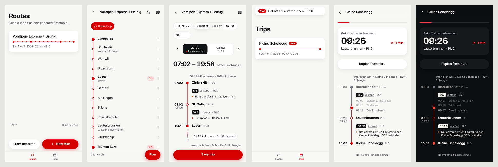

# Design: "The line"

A day trip is one rail line. Every screen draws it the same way, so nothing has to be explained.

## Principles

1. **One line, one accent.** The rail is the only colour (`--rail`). Solid dot: you get off (start, stops, end). Ring: the train passes through. Dotted grey: a walk. Dashed: "add a station".
2. **Hairlines, not boxes.** Surfaces only where something is tapped as a whole (tour cards, route chips, the options control).
3. **Numbers first.** Times are tabular and bold; departure–arrival is the largest type on the timeline.
4. **Thumb zone.** Each screen has one main action in the bottom dock (New tour, Plan, Share). Navigation sits top left, the map top right.
5. **Edit in place.** Tap a station's name and it becomes its own search field: type another, × and leave to remove it, the stay as a chip beside it. The grip moves it. Selects are the app's own (a chip and a list), never the system's. No dialogs, no settings screen.
6. **Smart defaults.** A route template runs in the direction that continues from your last station; a new trip is today, from now, with GA.
7. **Calm warnings.** A coloured dot and one line of text under the ride it concerns: red for disruptions, amber for things to check, blue for information.

## Tokens

All colours, radii and spacing are CSS custom properties in `src/styles/base.css` (`:root`, with a dark set under `prefers-color-scheme`). Text tokens `--ink`, `--ink-2` and `--ink-3` meet WCAG AA on `--bg` and `--surface` in both themes; the e2e axe checks enforce it.

## Navigation

One list (Now, Coming up) and one trip screen (SPEC §3a, 0.4.0). Every trip has a date; a finished one waits in search. Under way a trip shows itself live: a live bar on the list, and the app opens to it.

## Screens

- **List:** the mark and the app's name, the count as the large title ("2 ahead"), cards with the day as a big number (month and weekday under it), the name, the mini line and departure–arrival. Dock: New trip.
- **Trip:** header back · map · share · ⋯ (calendar, duplicate, delete). The date and the time it leaves from as one red line at the top (tap the date: 14 day pills and Other day; the time is a time field, today not before now), the name (tap to rename), departure → arrival as the headline (52 px), duration · trains · changes, the options as one segmented control with Earlier/Later chevrons (the chosen one dark, a dot on the recommended one). Then the line: times left, big dots where you get off, rings where the train passes (a scenic line's own stations lighter), dark names for the stations you entered (they open the panel), grey for what the timetable added (a tap says why), the train's badge, platform and duration under each departure, warnings as a coloured dot and one line. The dashed end adds a station.
- **Panel** (tap a station you entered): name field, No stop · Change · Stay (a stepper for how long; where you asked to ride through but the plan changes trains, it says so), "Via <line> ×", Add after, ↑, ↓, remove; a grip beside the name drags it.
- **Add sheet:** one search for stations, scenic lines and your past trips (each with its mini line and × to forget).
- **Under way:** progress bar, the next step as a card (with where its times come from), connections at risk in red, Replan from here, and the same line as the trip screen, read-only: expected times with their delay, the travelled part grey, a pulsing marker, the ride's stops open. A shared trip, a shared route and a trip over today show that line too (0.9.0); there is no second way to draw a trip.
- **Map:** full screen, a floating back button. Without the tile host the route is drawn on a plain ground, and a note says so.

## Reviewing a change

`SCREENSHOTS=/tmp/shots npx playwright test e2e/screens.spec.ts --project=phone` (after a build with `VITE_OJP_URL=https://ojp.invalid`) renders the list, a trip, its panel, the add sheet and a trip under way in light and dark from recorded data.
