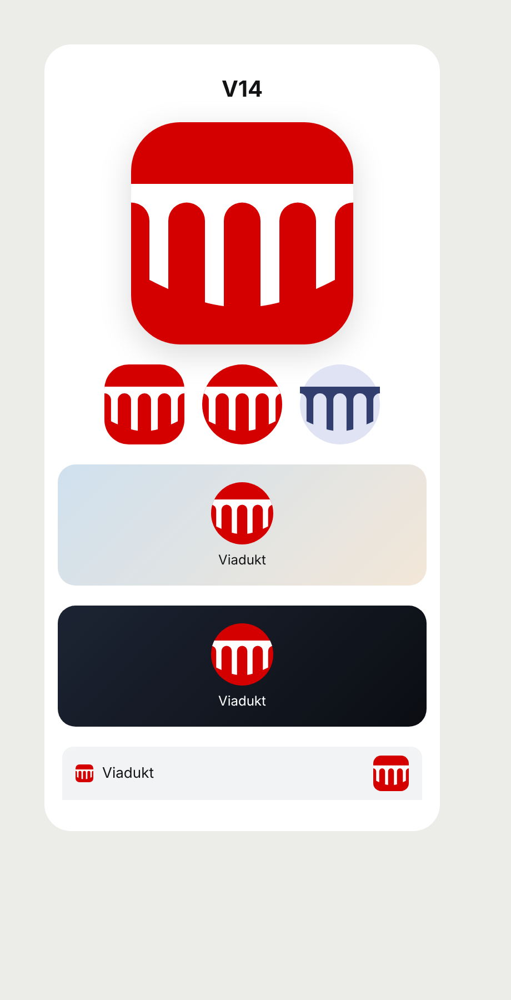

# Logo: V14

A viaduct seen from the side: a deck across the whole tile, three round arches and a half arch at each side, so the bridge runs on out of the icon; its piers stand in a valley, longest in the middle. Chosen 6 Nov 2026 (V14, draft G1), replacing V13 (a train front with the Alps in its window).

- **Geometry** (108-unit tile): deck y 30–39; arches every 27 units centred on x 0, 27, 54, 81, 108, each 17.8 wide with a round top on y 39; piers down to y = 72 + 18 · sin(π x / 108).
- **Colour:** flat red tile (`#D40000`), white mark (`#FFFFFF`). The arches are the tile showing through.
- **One colour** (status bar, notifications, Android 13 themed icon): the same shape in one colour.
- **Placement:** every surface draws the same 108-unit design; the rounded icon and favicon clip it to their corners; the adaptive icon's mask shows its middle, still three arches; the 24 dp notification icon is its full width in 22 dp.

One source, `scripts/logo-sets.py`: without arguments it writes `v14/` here; `--apply` writes `public/icons/{icon,maskable}.svg` and the Android launcher (red background, foreground), themed and notification vectors; then `npm run icons` for the PNGs. `src/ui/Logo.tsx` is the same path inline. Sheet: `CHROMIUM_PATH=… node scripts/logo-sheet.mjs`.
